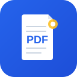

# 📄 PDF Master Pro

<div align="center">



**أداتك الكاملة لإدارة ملفات PDF - معالجة محلية 100% لضمان الخصوصية**

[تحميل الإضافة](#installation) • [المميزات](#features) • [الاستخدام](#usage) • [المساهمة](#contributing)

[](LICENSE)
[](https://chrome.google.com/webstore)
[](manifest.json)

</div>

---

## ✨ المميزات

### 🎨 واجهة مستخدم حديثة وسهلة
- تصميم عصري وأنيق يدعم الوضع الليلي
- واجهة سلسة ومتجاوبة على جميع الأجهزة
- دعم كامل للغة العربية والإنجليزية والفرنسية

### 🔒 الخصوصية أولاً
- **جميع العمليات تتم محلياً** - لا يتم رفع ملفاتك إلى أي خادم
- **بدون إنترنت** - تعمل بشكل كامل دون اتصال
- **آمن 100%** - بياناتك تبقى على جهازك فقط

### 🛠️ أدوات شاملة

#### 📑 إنشاء وتحويل
- **دمج PDF** - ادمج عدة ملفات PDF في ملف واحد
- **تقسيم PDF** - قسّم ملف PDF إلى ملفات منفصلة
- **JPG إلى PDF** - حوّل الصور إلى PDF
- **PDF إلى JPG** - استخرج الصور من PDF
- **Word إلى PDF** - حوّل مستندات Word (قريباً)
- **HTML إلى PDF** - حوّل صفحات الويب (قريباً)

#### ✏️ تعديل وتنظيم
- **ضغط PDF** - قلل حجم الملف مع الحفاظ على الجودة
- **تدوير الصفحات** - دوّر صفحات PDF
- **حذف الصفحات** - احذف صفحات معينة (قريباً)
- **استخراج الصفحات** - استخرج صفحات محددة (قريباً)
- **تنظيم PDF** - أعد ترتيب الصفحات (قريباً)
- **قص PDF** - اقتصاص الصفحات (قريباً)

#### 🔐 الأمان والحماية
- **حماية PDF** - أضف كلمة مرور للملف
- **فك الحماية** - أزل كلمة المرور من PDF
- **التوقيع الرقمي** - وقّع المستندات (قريباً)
- **التنقيح** - إخفاء المعلومات الحساسة (قريباً)

#### 🚀 أدوات متقدمة
- **OCR PDF** - اجعل النصوص في الصور قابلة للبحث
- **ترقيم الصفحات** - أضف أرقام صفحات
- **العلامة المائية** - أضف علامة نصية أو صورة
- **المقارنة** - قارن ملفين PDF (قريباً)
- **الإصلاح** - أصلح ملفات PDF التالفة (قريباً)

---

## 📥 <a name="installation"></a>التثبيت

### من متجر Chrome Web Store (قريباً)
1. افتح [رابط الإضافة](https://chrome.google.com/webstore)
2. اضغط "Add to Chrome"
3. استمتع!

### التثبيت اليدوي للمطورين
1. قم بتحميل المشروع:
```bash
git clone https://github.com/yourusername/pdf-master-pro.git
cd pdf-master-pro
```

2. افتح Chrome واذهب إلى:
```
chrome://extensions/
```

3. فعّل "Developer mode" في الأعلى

4. اضغط "Load unpacked" واختر مجلد المشروع

5. جاهز للاستخدام! 🎉

---

## 🎯 <a name="usage"></a>كيفية الاستخدام

### الطريقة الأولى: من لوحة التحكم
1. اضغط على أيقونة الإضافة في Chrome
2. اضغط "Open Dashboard"
3. اختر الأداة التي تريدها
4. ارفع ملفك أو اسحبه إلى الصفحة
5. اضغط "Process" واحصل على النتيجة!

### الطريقة الثانية: من القائمة السريعة
1. انقر بزر الفأرة الأيمن على أي ملف PDF
2. اختر "PDF Master Pro"
3. اختر العملية المطلوبة
4. تم! 

### الطريقة الثالثة: السحب والإفلات
- ببساطة اسحب ملف PDF إلى نافذة المتصفح
- ستفتح لوحة التحكم تلقائياً مع الملف جاهز للمعالجة

---

## 🌍 اللغات المدعومة

- 🇬🇧 **English** - إنجليزي
- 🇸🇦 **العربية** - Arabic
- 🇫🇷 **Français** - فرنسي

### إضافة لغة جديدة
يمكنك المساهمة بإضافة لغتك! راجع ملف [`utils/translations.js`](utils/translations.js)

---

## 🛠️ <a name="contributing"></a>المساهمة في المشروع

نرحب بمساهماتكم! 🎉

### كيفية المساهمة
1. Fork المشروع
2. أنشئ branch جديد (`git checkout -b feature/amazing-feature`)
3. قم بالتعديلات (`git commit -m 'Add amazing feature'`)
4. ادفع التغييرات (`git push origin feature/amazing-feature`)
5. افتح Pull Request

### المساهمون
شكراً لكل من ساهم في هذا المشروع! ❤️

---

## 🏗️ البنية التقنية

### التقنيات المستخدمة
- **Frontend**: HTML5, CSS3, JavaScript (ES6+)
- **PDF Processing**: [PDF-lib](https://pdf-lib.js.org/)
- **PDF Rendering**: [PDF.js](https://mozilla.github.io/pdf.js/)
- **OCR**: [Tesseract.js](https://tesseract.projectnaptha.com/)
- **Storage**: Chrome Storage API & IndexedDB
- **Manifest**: V3 (أحدث إصدار)

### هيكل المشروع
```
pdf-master-pro/
├── dashboard/          # لوحة التحكم الرئيسية
│   ├── components/     # مكونات React-like
│   ├── app.js         # نقطة البداية
│   └── styles.css     # التصاميم
├── tools/             # أدوات PDF
│   ├── merge/
│   ├── split/
│   ├── compress/
│   └── ...
├── utils/             # أدوات مساعدة
│   ├── i18n.js       # نظام الترجمة
│   └── storage.js    # إدارة التخزين
├── lib/              # المكتبات الخارجية
├── background/       # Service Worker
└── manifest.json     # إعدادات الإضافة
```

---

## 📊 متطلبات النظام

- **Chrome**: الإصدار 88 أو أحدث
- **Edge**: الإصدار 88 أو أحدث
- **Brave**: الإصدار 1.20 أو أحدث
- **Opera**: الإصدار 74 أو أحدث

---

## 🐛 الإبلاغ عن مشكلة

وجدت مشكلة؟ نريد أن نسمع منك!

1. افتح [Issue جديد](https://github.com/yourusername/pdf-master-pro/issues/new)
2. صِف المشكلة بالتفصيل
3. أرفق لقطات شاشة إن أمكن
4. ذكر نظام التشغيل ونسخة المتصفح

---

## 📜 الترخيص

هذا المشروع مرخص تحت رخصة MIT - راجع ملف [LICENSE](LICENSE) للتفاصيل.

---

## 📞 تواصل معنا

- **GitHub Issues**: [Report a bug](https://github.com/yourusername/pdf-master-pro/issues)
- **Email**: support@pdfmasterpro.com
- **Twitter**: [@PDFMasterPro](https://twitter.com/PDFMasterPro)
- **Discord**: [Join our community](https://discord.gg/pdfmasterpro)

---

## 💖 الدعم

إذا أعجبك هذا المشروع:
- ⭐ ضع نجمة للمشروع على GitHub
- 🐦 شارك المشروع مع أصدقائك
- ☕ ادعمنا بقهوة عبر [Buy Me a Coffee](https://buymeacoffee.com/pdfmasterpro)

---

## 🗺️ خارطة الطريق

- [ ] إضافة المزيد من أدوات التحويل (Word, Excel, PowerPoint)
- [ ] تحسين سرعة المعالجة
- [ ] إضافة معالجة دفعية (Batch Processing)
- [ ] دعم المزيد من اللغات
- [ ] إنشاء نسخة للهواتف المحمولة
- [ ] API للمطورين

---

<div align="center">

**صُنع بـ ❤️ لمجتمع المطورين العرب**

[⬆ العودة للأعلى](#top)

</div>

